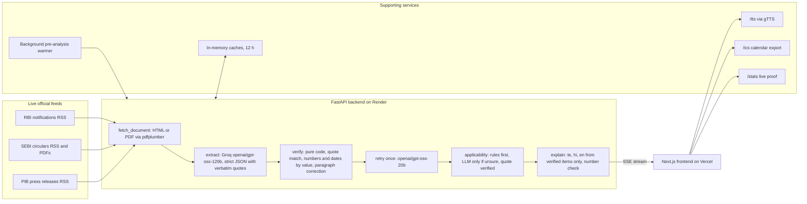

# Pramaan

**New rules, explained in your language — every line proved.**

Pramaan fetches live RBI, SEBI and PIB notices, extracts each obligation with a verbatim quote, proves every quote, date and number in code, checks whether it applies to you, and explains the verified duties in Telugu, Hindi or English with voice.

| | |
|---|---|
| Live app | https://pramaan-flame.vercel.app |
| Backend health | https://pramaan-api-7904.onrender.com/health |
| Live proof stats | https://pramaan-api-7904.onrender.com/stats |
| Demo video | <VIDEO_LINK> |
| Pitch deck | <DECK_LINK> |

**Track:** Theme 1 — Civic Pulse, Digital Governance & Public Information (Multilingual Policy, Rights & Scheme Explainer + regulatory compliance).

---

## 1. Problem Statement

### Target issue & context

RBI, SEBI and government ministries publish new notices every week as long English legal text, often as PDFs. Readers must work out whether a notice applies to them, what it requires, and by when. Missed obligations mean penalties for regulated entities and missed rights or deadlines for citizens. AI summaries that hallucinate make this worse: a confident wrong deadline is more dangerous than no summary.

### Target audience

- Small regulated entities: NBFCs, co-operative banks, stock brokers, SEBI research analysts.
- CAs and compliance consultants who track rules for many clients.
- Citizens and small businesses affected by government notices, many of them more comfortable in Telugu or Hindi.

---

## 2. Solution Description

### High-level overview

User flow:

1. Pick a profile (NBFC, co-operative bank, research analyst, stock broker, citizen / MSME) and a language (English, Telugu, Hindi).
2. The home page lists the newest live notices from RBI, SEBI and PIB, sorted by whether they apply to that profile.
3. Open a notice and watch the agent's steps stream live.
4. Read the verified duties, each with its exact source quote, who it applies to and its deadline. Click a quote to see it highlighted in the official text.
5. Read (and listen to) a Telugu, Hindi or English explainer generated from the verified duties only.
6. Export verified deadlines to a calendar (`.ics`).

Core idea: **the AI reads and writes; code checks. Nothing reaches the user unless its exact quote is found in the official document.** Items that fail the check are shown as rejected with the reason, never hidden.

### Agentic workflow

The UI streams these six steps over SSE (`/analyze`). Each step reports status (`running`, `done`, `failed`), time taken and a detail line.

| # | Step | AI or code | Model | Output | Error handling |
|---|---|---|---|---|---|
| 1 | `fetch_document` | Code | none | Numbered paragraphs (the document's own numbering, else `p<index>`) | Host allowlist (redirects checked too); 10 s timeout, 2 retries with backoff; SEBI shell pages follow the iframe to the PDF, read with pdfplumber; unreadable or image-only PDFs give a readable error that links the original |
| 2 | `extract` | AI | `openai/gpt-oss-120b` (primary) | Strict-JSON obligations: who, must_do, deadline, effective_from, paragraph, **verbatim quote** | Invalid JSON: one retry with the validation error included. 429 / 5xx / timeout: backoff, then the fast model. Long documents are chunked with overlap. Failures become a typed `LLMError` and a `failed` step event |
| 3 | `verify` | Code | none | Each obligation marked `verified`, `near` or `rejected` with reason and match span | Pure code, cannot fail on model output; rejected items stay visible |
| 4 | Self-correct once | AI, then code | `openai/gpt-oss-20b` (fast) | Repaired quotes for rejected items; tighter summaries. Result marked `fixed` only if it passes `verify` again | Exactly one pass, one LLM call. If it fails, the originals are returned unchanged |
| 5 | `applicability` | Code first, AI if unsure | Fast model, only if rules are unsure | `yes`, `no` or `review` with a reason and a verified quote | Addressee rules per profile run first with no LLM. If the quote behind a yes/no cannot be found in the document, the answer becomes `review`. Never raises |
| 6 | `explain` | AI, then code | Primary model | Telugu / Hindi / English explainer text | Input is verified items only. Every number and date in the answer must exist in those items; Telugu/Hindi answers must contain enough native-script letters. Otherwise regenerate once, then fall back to a template. With no verified duties, a plain note is shown and no LLM is called |

Cross-cutting behaviour:

- All Groq calls go through one module (`llm/client.py`). Transient failures follow primary → 1 s → primary → fast → 2 s → fast.
- The client honours `retry-after` up to 30 s and surfaces the wait live as "waiting for AI capacity (~Ns)".
- At most four requests are in flight. Every call logs model, tokens and latency.
- The API layer never receives a raw exception: errors are `LLMError(kind=rate_limit|invalid_output|unavailable|config)` with user-readable messages, and the stream ends with an `error` event instead of a crash.
- The server sends an SSE ping every 10 s and stops its work when the client disconnects.

### Technical architecture



#### Tech stack

| Layer | Technology | Why |
|---|---|---|
| Backend | Python 3.11, FastAPI, uvicorn | Async I/O and SSE streaming with typed routes |
| Contracts | Pydantic v2 (mirrored in `frontend/lib/types.ts`) | One schema for the LLM output, the API and the UI |
| Fetching | httpx, feedparser, selectolax, pdfplumber | Live feeds, fast HTML parsing, PDF text for SEBI circulars |
| Verification | rapidfuzz, dateparser | Near-match scoring; dates parsed by value (including SEBI's `30 Oct, 2026` format) |
| LLM | Groq SDK, `openai/gpt-oss-120b` and `openai/gpt-oss-20b` | Fast inference; model names come from environment variables |
| Voice | Browser speech synthesis (English), gTTS (Telugu, Hindi) | Telugu/Hindi voices are not available on most devices |
| Calendar | `ics` | Verified deadlines as one all-day event each |
| Caching | cachetools (in-memory TTL) | No database needed; the fetch time is always shown |
| Frontend | Next.js (App Router), TypeScript, Tailwind, shadcn/ui, lucide-react | Calls the backend directly so SSE streams work |
| Hosting | Render (backend), Vercel (frontend) | Free tiers, deploy from GitHub |

#### Datasets / data sources

| Source | Feed | Official site |
|---|---|---|
| RBI notifications | https://www.rbi.org.in/notifications_rss.xml | https://www.rbi.org.in |
| SEBI circulars (items under `/legal/circulars/`, plus the linked PDFs) | https://www.sebi.gov.in/sebirss.xml | https://www.sebi.gov.in |
| PIB press releases (English) | https://www.pib.gov.in/RssMain.aspx?ModId=6&Lang=1&Regid=3&reg=3 | https://pib.gov.in |

No dummy, mock or stored datasets. Every notice is fetched live from the official source at request time; results are cached in memory (max 12 h) and the fetch time is always shown.

Pasted links are accepted only from `rbi.org.in`, `rbidocs.rbi.org.in`, `sebi.gov.in` and `pib.gov.in` (exact hosts, with `www.`).

#### Repository structure

```
pramaan/
├── backend/
│   ├── sources/    feeds, HTTP client, host allowlist, status cache, page check
│   ├── pipeline/   fetch_document, paragraphs, extract, retry, applicability, explain, ics_export, fake_claim, stats, warmer
│   ├── verify/     normalize, quotes, numbers, verifier (pure code)
│   ├── llm/        Groq client, typed errors, usage log, prompts/*.md
│   ├── api/        FastAPI app, routes, Pydantic schemas, /analyze SSE
│   ├── tests/      offline unit and API tests; live tests marked @pytest.mark.live
│   ├── eval/       evaluation-only area, never imported by the app
│   └── scripts/    probes and demos for manual checks
├── frontend/
│   ├── app/        pages: home, circular view, how-it-works, share images
│   ├── components/ UI: notice list, agent timeline, obligation cards, source panel, proof stats
│   └── lib/        typed API client, SSE hook, profile and language storage, speech
├── docs/           PLAN.md, EDGE_CASES.md
└── render.yaml     Render service definition
```

| Module | Responsibility |
|---|---|
| `backend/sources` | Live RSS fetching, 10 s timeout with retries, exact-host allowlist, readable errors |
| `backend/pipeline` | The agent steps, plus applicability, explainer, calendar export, warmer and stats |
| `backend/verify` | The guardrail. A test enforces that it never imports groq, httpx or llm |
| `backend/llm` | The only place that talks to Groq; fallback, retries, strict schemas, usage log |
| `backend/api` | Routes, SSE stream, caches and per-URL locks |
| `frontend/app` and `components` | Pages and components that render the stream and the proof |
| `frontend/lib` | `types.ts` mirrors `api/schemas.py`; `api.ts` is the only network layer |

---

## 3. Prototype Link

- Live app: https://pramaan-flame.vercel.app
- Backend health: https://pramaan-api-7904.onrender.com/health

Free-tier hosting sleeps when idle, so the first request can take up to a minute. The app shows "Waking up the server…" while it retries.

---

## 4. Demo Video

<VIDEO_LINK>

2–3 minute end-to-end demonstration recorded on the live deployed app.

---

## 5. How Pramaan meets the evaluation pillars

| Pillar (weight) | Evidence in the repo and the app |
|---|---|
| **Technical Architecture & Engineering Depth (20)** | Modular pipeline (`sources`, `pipeline`, `verify`, `llm`, `api`). Typed Pydantic contracts mirrored in TypeScript. SSE streaming with keep-alive pings and client-disconnect cancellation. In-memory TTL caches plus per-URL locks, so two visitors opening the same notice share one analysis. A background warmer pre-analyses this week's notices one at a time, paced under Groq's per-minute limit and paused while any user request runs. 431 offline tests, plus 7 live tests that are excluded by default (`pytest --collect-only -q` reports 431/438 collected, 7 deselected). |
| **AI Reasoning & Agentic Execution (25)** | Multi-step tool pipeline (fetch, extract, verify, self-correct, applicability, explain). One self-correction pass whose output must pass the verifier again. Fallback model on 429/5xx. Rate-limit waits shown live in the timeline. Guardrails: verbatim-quote verification; number and date checks by value; rejected items shown, not hidden; explainer built from verified items only; prompt-injection handling (document text wrapped in random-marker data blocks, and the verifier is plain code); a live "Test the verifier"; live [`/stats`](https://pramaan-api-7904.onrender.com/stats). Note: `/stats` measures grounding (how much of what the model produced is provably in the source), not recall. |
| **Problem Relevance, Impact & USP (25)** | Real weekly regulatory notices, not a toy dataset. Profile-specific applicability. Telugu and Hindi explanations with voice. Proof for every line: each duty links to its exact quote in the official text. Generic chatbots and summarisers cannot show where a sentence came from; Pramaan refuses to show a duty it cannot prove. |
| **Live Demonstration & Robustness (30)** | 17 edge cases reviewed in [`docs/EDGE_CASES.md`](docs/EDGE_CASES.md) (summary below). Graceful, typed errors with no tracebacks. Cold-start handling on the front end. Pre-analysed and cached circulars open instantly. |

Edge cases handled (details and how each was verified are in `docs/EDGE_CASES.md`):

- A source is down or times out; an empty feed.
- A notice with no duties; all duties rejected.
- A page that is only a shell around a PDF; very long documents; Hindi-only documents.
- Groq invalid JSON; Groq 429 waits.
- Non-government or look-alike URLs; empty or garbage input.
- No Telugu/Hindi browser voice; prompt injection inside a document.
- Render cold start; SSE connection drops; double-clicks; switching language mid-stream.

---

## 6. Guardrails in detail

`verify/` is pure code. It never imports groq, httpx or llm, and a test enforces that.

**How the verifier decides**

1. **Normalisation.** Both the quote and the source are lowercased, whitespace is collapsed, and quotes and dashes are unified. Devanagari-safe.
2. **Exact match.** The normalised quote must be a substring of the normalised source.
3. **Near match.** If there is no exact match, a sliding-window rapidfuzz comparison must score at least 92. The result is marked `near`.
4. **Numbers and dates by value.** Every number (including rupee amounts, lakh/crore, percentages, Indian digit grouping, Devanagari digits) and every date in `must_do`, `deadline` and `effective_from` must appear in the matched text. They are compared by value, so "30" matches "३०", and dates are parsed to a calendar date before comparing.
5. **Paragraph correction.** If the model cites the wrong paragraph but the quote is found elsewhere, the paragraph is corrected and flagged.
6. **Rejection.** Anything else is kept and marked `rejected` with a reason:
   - `quote too short to verify`
   - `quote not found in source` (with the best score)
   - `number/date not in source: …`

**Self-correction rule.** There is at most one pass. The model may propose a repaired quote for rejected items, but the repaired item goes back through the same verifier and is marked `fixed` only if it passes. The model never decides what is accepted.

**Test the verifier.** On the circular page, `verifier_test=1` injects a realistic fabricated duty on purpose: it reads like a real obligation for that source and has a plausible deadline. It is built from templates and checked against the real verifier first, so it is guaranteed to be rejected because its quote is not in the document. It is clearly labelled as a test, and it is always rejected live. It is excluded from the proof stats, which count only the injected-test catch rate separately.

---

## 7. Setup & Installation

### Prerequisites

- Python 3.11
- Node.js 20+
- A Groq API key (https://console.groq.com)

### Backend

```bash
cp .env.example .env          # repo root; then fill in the values
cd backend
python3.11 -m venv .venv
source .venv/bin/activate
pip install -r requirements.txt
uvicorn api.main:app --reload # http://localhost:8000
```

Tests:

```bash
pytest -q          # offline; live tests are excluded
pytest -m live     # needs a key and network; run alone, the free tier may rate-limit
```

### Frontend

```bash
cd frontend
npm install
echo "NEXT_PUBLIC_API_URL=http://localhost:8000" > .env.local
npm run dev        # http://localhost:3000
```

### Environment variables

| Variable | Where | Purpose |
|---|---|---|
| `GROQ_API_KEY` | backend | Groq authentication. Never commit it |
| `GROQ_MODEL_PRIMARY` | backend | Large model for extraction and the Telugu/Hindi explainer |
| `GROQ_MODEL_FAST` | backend | Smaller model for the self-correction pass, classification and as the fallback |
| `ALLOWED_ORIGIN` | backend | The only origin CORS allows (the frontend URL) |
| `NEXT_PUBLIC_API_URL` | frontend | Base URL of the backend |

### Deployment

- **Backend (Render):** `render.yaml` defines a Python web service; build is `cd backend && pip install -r requirements.txt`, start is `cd backend && uvicorn api.main:app --host 0.0.0.0 --port $PORT`. Secret values are set in the Render dashboard, not in the file.
- **Frontend (Vercel):** import the repo with the root directory set to `frontend`, and set `NEXT_PUBLIC_API_URL` to the Render URL.

---

## 8. API Reference

| Endpoint | Method | Params | Returns |
|---|---|---|---|
| `/health` | GET | none | Per-source status (`ok`, `last_fetch`, `count`, `error`), LLM status and runtime status. Cached 5 min |
| `/notices` | GET | `profile`, `lang` | Newest 8 notices per source with `applies` (`yes`, `no`, `review`) and a reason, plus per-source status. Applicability by rules only (no LLM). Cached 10 min per profile |
| `/analyze` | GET | `url`, `profile`, `lang`, `verifier_test` (0 or 1) | `text/event-stream`. Events: `step` (name, status, ms, detail), then `result` (document, obligations with status and match span, counts, applicability, explainer, LLM info) or `error` (step, message, url) |
| `/tts` | GET | `text`, `lang` | `audio/mpeg` via gTTS. Max 1200 characters (else 400 JSON); gTTS down gives 503 JSON. Cached 30 min |
| `/ics` | GET | `url`, `profile` | `text/calendar` with one all-day event per verified, near or fixed obligation that has a deadline. Header `X-Pramaan-Events: <n>` |
| `/doc` | GET | `url` | Title, URL, fetch time and numbered paragraphs of an already analysed document, from cache only (404 if not cached) |
| `/stats` | GET | none | Live proof stats since the server started: circulars analysed, duties extracted, counts by status, verifier-test catch rate, latency |
| `/warm/status` | GET | none | Background pre-analysis state: `running`, `queued`, `cached_count`, `last_run_at` |

Profiles: `nbfc`, `coop_bank`, `research_analyst`, `stock_broker`, `citizen_msme`. Languages: `en`, `te`, `hi`.

---

## 9. Compliance with Forge rules

- **Live data only.** No hardcoded or mock data; tests use short inline strings only.
- **Built during the hackathon window** (30 Oct – 1 Nov 2026), with open-source libraries only. See the commit history.
- **Both team members can explain the full architecture.**
- **The demo video shows the real deployed app.**
- No API keys in code or commits; keys live in `.env` locally and in Render/Vercel environment variables.

---

## 10. Honest limits

- Groq's free tier allows 8,000 tokens per minute per model. A fresh analysis can wait about 30 s; pre-analysed and cached ones are instant.
- Source documents must be in English (Hindi-only documents are handled by the verifier, but extraction quality on them was not tested on a real circular).
- Three sources so far: RBI, SEBI, PIB.
- The verifier proves grounding, not completeness. A duty that is shown is in the source; a duty the model missed is not flagged.
- Applicability is a best-effort match to a profile and says "review" when unsure.
- Always confirm with the original notice before acting.

---

## 11. Roadmap

- More regulators: GST/CBIC, DGFT, state gazettes.
- WhatsApp delivery.
- Per-profile alerts.
- More Indian languages.
- Scheme-eligibility checks for citizens.

---

## 12. Team

**CTRL + AI** — Akshay Kumar Korepu & Ragula Thirumal, NIT Warangal. Built at Forge '26.

---

*Independent tool. Not affiliated with RBI, SEBI or the Government of India.*
