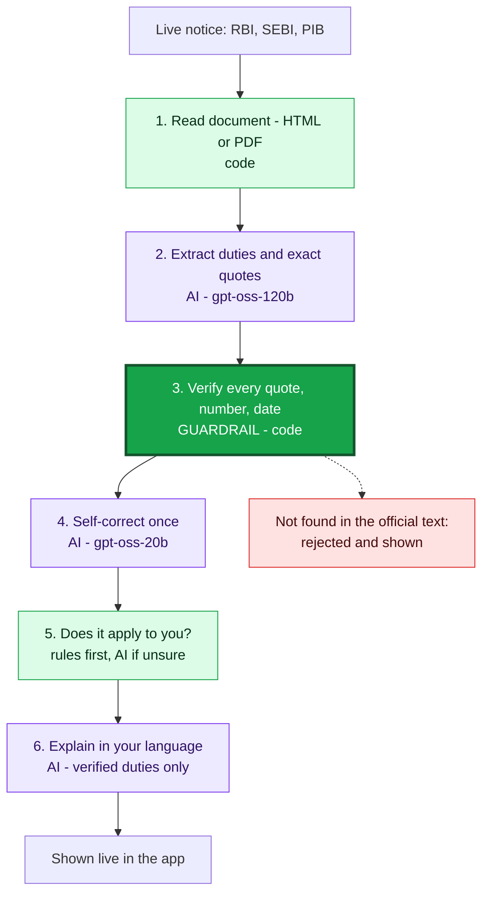
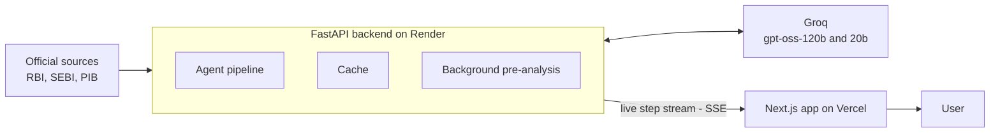

# Pramaan

**New rules, explained in your language — every line proved.**

Pramaan reads live RBI, SEBI and PIB notices, tells you which ones apply to you, and explains them in Telugu, Hindi or English — with every claim checked against the official text.

| | |
|---|---|
| Live app | https://pramaan-flame.vercel.app |
| Demo video | <VIDEO_LINK> |
| Pitch deck | <DECK_LINK> |
| Live proof stats | https://pramaan-api-7904.onrender.com/stats |

Forge '26 · Theme 1: Civic Pulse, Digital Governance & Public Information · Team CTRL + AI (NIT Warangal)

---

## The problem

- New rules arrive every week as long English legal text, often PDFs.
- Readers can't tell what applies to them, what to do, or by when.
- Generic AI summaries can invent duties and deadlines.

Who is affected: small NBFCs, co-op banks, stock brokers, research analysts, CAs, and citizens who prefer Telugu or Hindi.

## What Pramaan does


## How it works



**The AI reads and writes. Code checks. Nothing reaches you unless its exact quote is in the official document.**

## Why you can trust it

| Guardrail | What it means |
|---|---|
| Exact quotes required | Every duty must carry a word-for-word quote from the notice |
| Code does the checking | Quotes, numbers and dates are compared in plain code, not by AI |
| Rejected claims stay visible | Failed items are shown with the reason, never hidden |
| One self-correction only | The AI gets one repair pass, and the result is checked again |
| Verified duties only | The Telugu/Hindi explainer never sees raw document text |
| "Test the verifier" | Inserts a fake duty live. It is always rejected |

Live numbers: [/stats](https://pramaan-api-7904.onrender.com/stats). Edge cases handled: [docs/EDGE_CASES.md](docs/EDGE_CASES.md).

Verified means grounded in the source, not that every duty was found. Always confirm with the original notice.

## Architecture



| Part | Technology |
|---|---|
| Frontend | Next.js (App Router), TypeScript, Tailwind, shadcn/ui |
| Backend | Python 3.11, FastAPI, httpx, feedparser, selectolax |
| AI models | Groq: openai/gpt-oss-120b (main), openai/gpt-oss-20b (fast) |
| Verification | rapidfuzz, dateparser, Pydantic |
| PDF reading | pdfplumber |
| Voice | Browser speech (English), gTTS (Telugu, Hindi) |
| Hosting | Render (backend), Vercel (frontend) |
| Tests | 431 offline tests (7 more live tests run separately) |

Live official sources only — no stored or dummy data. Results are cached for up to 12 hours with the fetch time shown.

## Run it locally

Backend:

```bash
cd backend
python -m venv .venv && source .venv/bin/activate
pip install -r requirements.txt
cp ../.env.example ../.env     # add your GROQ_API_KEY
uvicorn api.main:app --reload
pytest -q
```

Frontend:

```bash
cd frontend
npm install
echo "NEXT_PUBLIC_API_URL=http://localhost:8000" > .env.local
npm run dev
```

| Variable | Purpose |
|---|---|
| `GROQ_API_KEY` | Groq access (never commit it) |
| `GROQ_MODEL_PRIMARY` | Main model for extraction and explaining |
| `GROQ_MODEL_FAST` | Smaller model for repair, classification, fallback |
| `ALLOWED_ORIGIN` | Frontend URL allowed by CORS |
| `NEXT_PUBLIC_API_URL` | Backend URL, used by the frontend |

## Project structure

```
pramaan/
├── backend/
│   ├── sources/    live feeds, allowlist, HTTP
│   ├── pipeline/   the agent steps
│   ├── verify/     the guardrail, pure code
│   ├── llm/        Groq client and prompts
│   ├── api/        routes and live stream
│   └── tests/      offline and live tests
├── frontend/
│   ├── app/        pages
│   ├── components/ notices, timeline, proof UI
│   └── lib/        typed API client
├── docs/           plan and edge cases
└── render.yaml     backend deploy config
```

## Limits & what's next

Limits:

- Free-tier AI can make a first analysis wait about 30 s. Cached and pre-analysed notices are instant.
- Source documents must be in English.
- Three sources so far: RBI, SEBI, PIB.
- The free server sleeps when idle, so the first visit can take up to a minute.

Next:

- GST/CBIC, DGFT and state gazettes
- WhatsApp delivery
- Per-profile alerts
- More Indian languages

## Team

Akshay Kumar Korepu & Ragula Thirumal — NIT Warangal · Built during Forge '26 (30 Oct – 1 Nov 2026).

---

*Independent tool. Not affiliated with RBI, SEBI or the Government of India.*
