<div align="center">

# Pramaan

**New rules, explained in your language — every line proved.**

[](https://pramaan-flame.vercel.app)
[](https://drive.google.com/drive/folders/1wb3QtAR_4_E0s3zuUZm6pzEy2A_pLsfB)


[Live app](https://pramaan-flame.vercel.app) · [Demo video & deck](https://drive.google.com/drive/folders/1wb3QtAR_4_E0s3zuUZm6pzEy2A_pLsfB) · [Proof stats](https://pramaan-api-7904.onrender.com/stats)

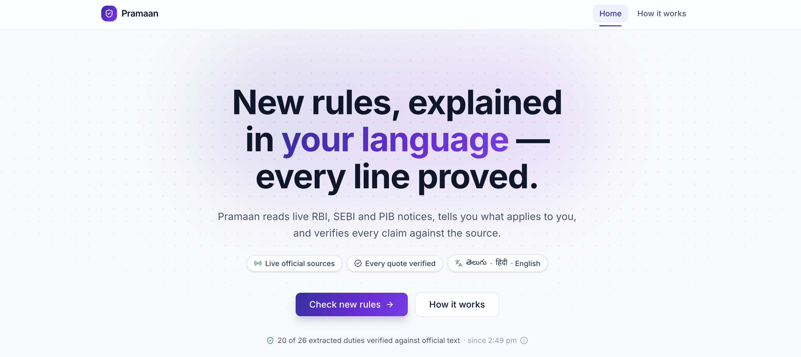

</div>

## Watch it work

<div align="center">
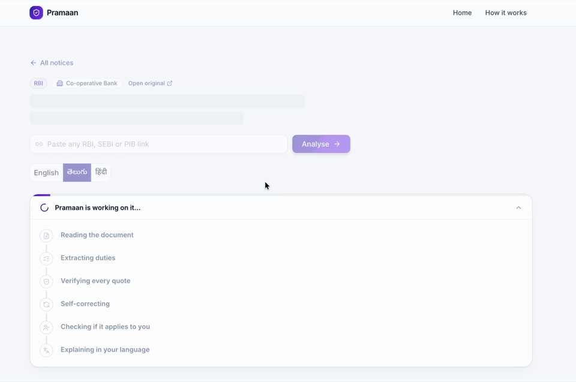
</div>

The six agent steps stream in live on a real RBI circular. This notice was pre-analysed, so it finishes fast.

## The problem

- New rules arrive every week as long English legal text, often PDFs.
- Readers cannot tell if a rule applies to them, what to do, or by when.
- AI chatbots can invent duties and deadlines.

**Who is affected:** small NBFCs, co-operative banks, stock brokers, SEBI research analysts, CAs, and citizens who prefer Telugu or Hindi.

**Why it matters:** missed rules mean penalties and lost rights. This is Civic Pulse: accessible, verified public information and easier compliance.

## Our solution

Pramaan reads live RBI, SEBI and PIB notices, tells you which ones apply to you, and explains the duties in Telugu, Hindi or English. Every duty carries the exact sentence it came from.

**The AI reads and writes. Code checks.**

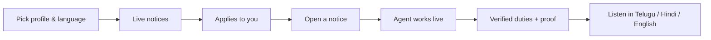

| Feature | What it does |
|---|---|
| Live notices | Newest RBI, SEBI and PIB items, fetched when you open the app |
| Verified duties with proof | Each duty shows its word-for-word quote from the official text |
| Show in document | Opens the source with the quote highlighted |
| Test the verifier | Inserts a fake duty on purpose and shows it being rejected |
| Regional-language voice | Telugu, Hindi or English explainer with a Listen button |
| Live proof stats | Running totals of what was verified and rejected, at `/stats` |

<table>
<tr>
<td width="50%">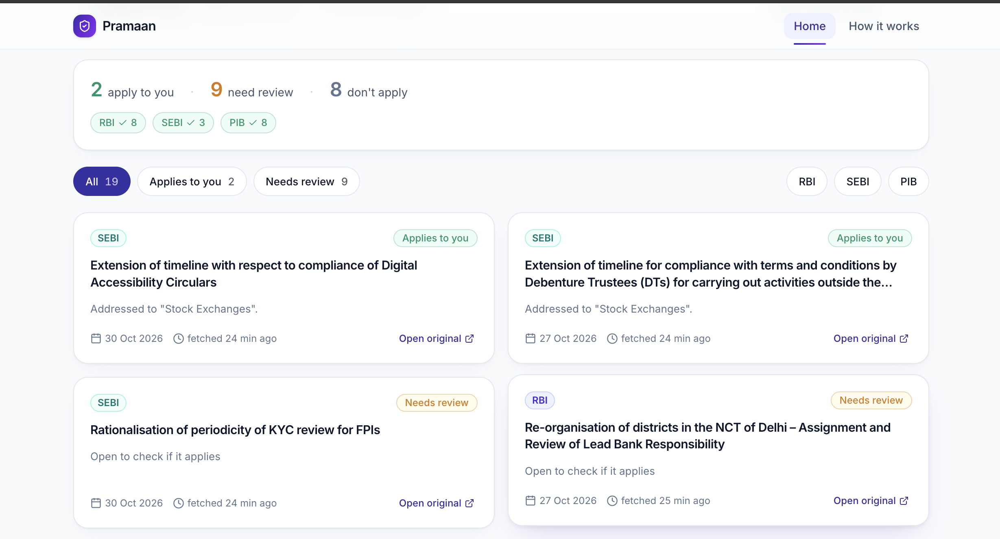<br><sub><b>Notices that apply to you</b></sub></td>
<td width="50%">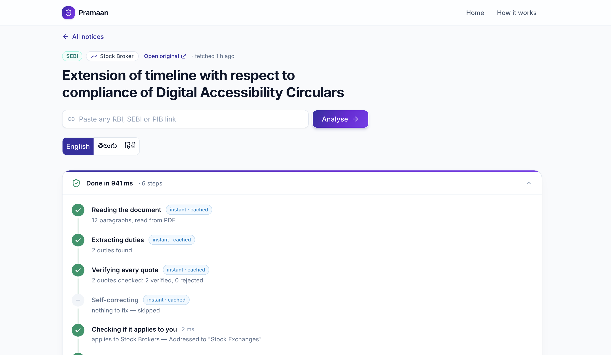<br><sub><b>Agent steps on a circular</b></sub></td>
</tr>
<tr>
<td>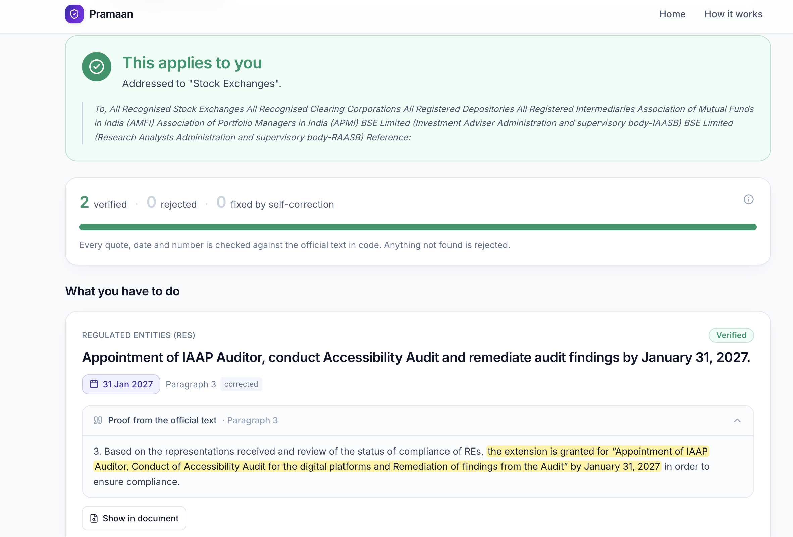<br><sub><b>Quote proved in the text</b></sub></td>
<td>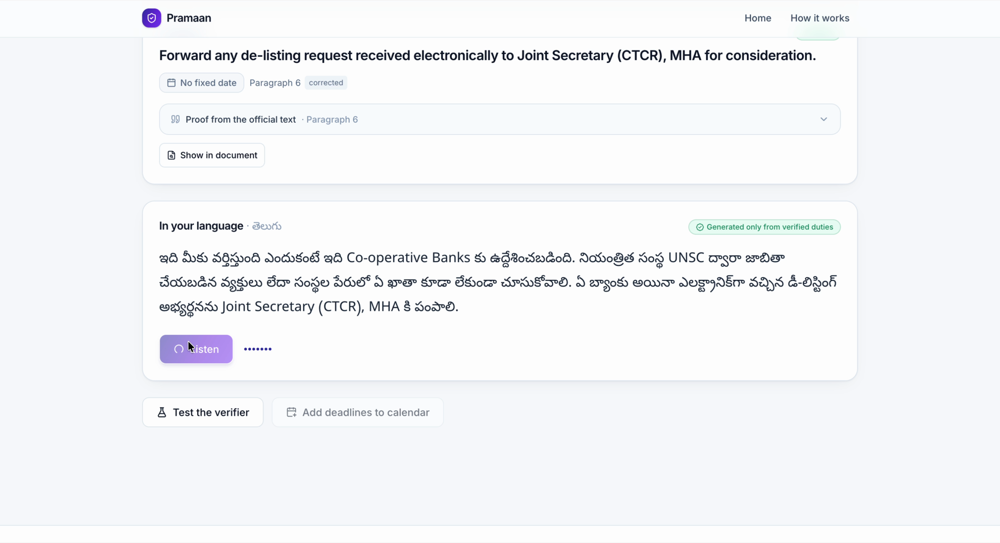<br><sub><b>Telugu explainer with voice</b></sub></td>
</tr>
<tr>
<td>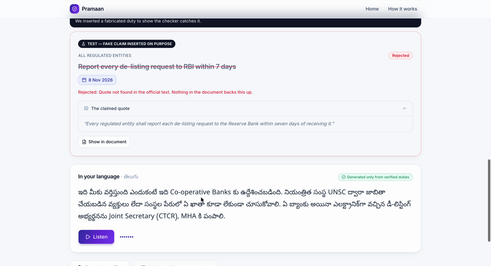<br><sub><b>Fake duty rejected</b></sub></td>
<td>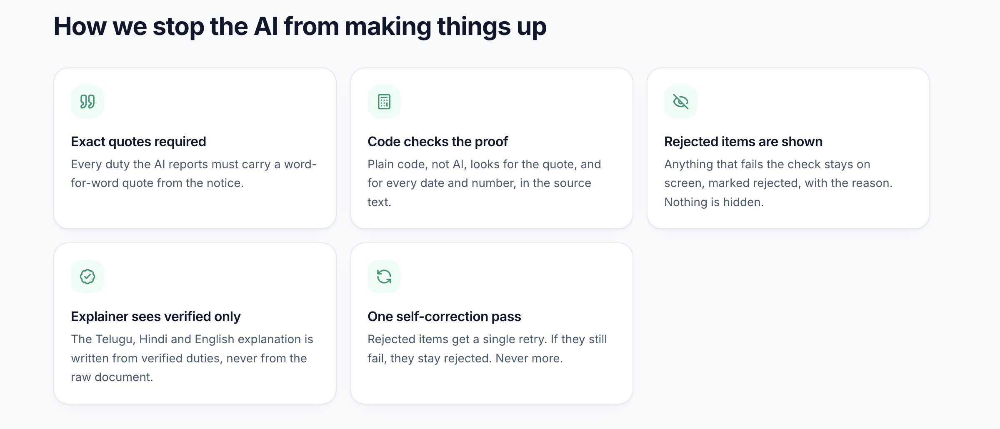<br><sub><b>Live proof stats</b></sub></td>
</tr>
</table>

## How the agent works

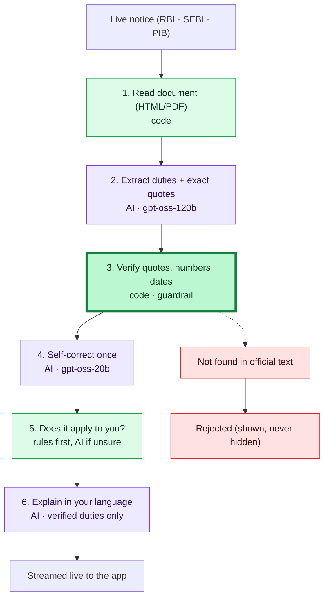

<div align="center">
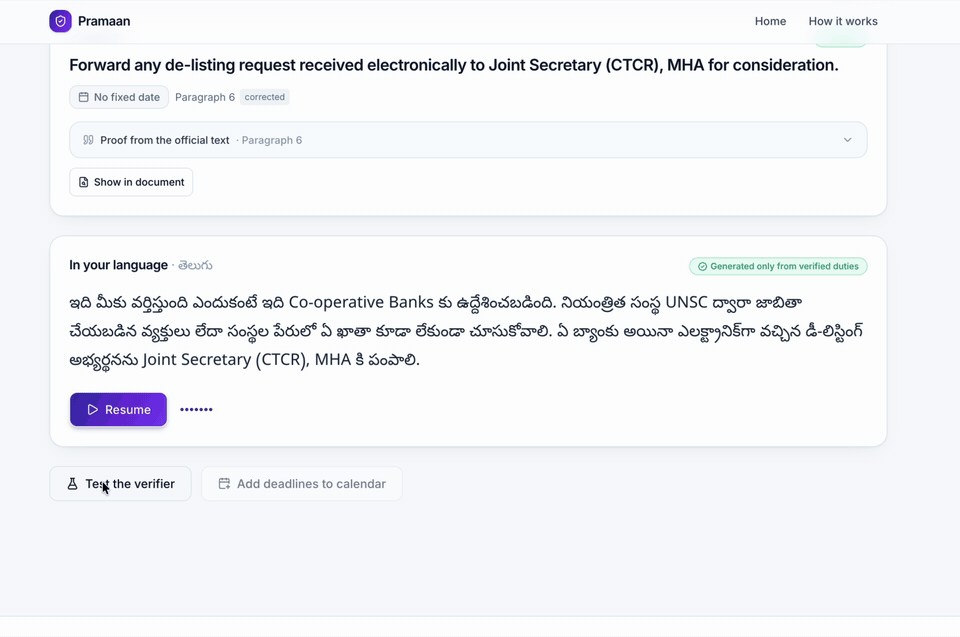
</div>

A fake duty is inserted on purpose — the verifier rejects it live.

| Guardrail | Why it matters |
|---|---|
| Exact quote required | Every duty must carry a word-for-word quote from the notice |
| Code does the checking | Quotes, numbers and dates are compared in plain code, not by AI |
| Rejected items stay visible | Failed items are shown with the reason, never hidden |
| One self-correction only | The AI gets one repair pass, and the result is checked again |
| Verified duties only | The Telugu/Hindi explainer never sees raw document text |
| Live data only | No stored, mock or dummy notices |

Verified means grounded in the official text. It is not proof that every duty was found. Always confirm with the original.

## Technical architecture

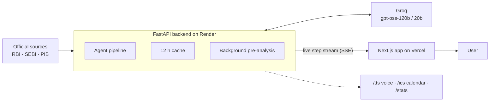

| Layer | Technology |
|---|---|
| Frontend | Next.js (App Router), TypeScript, Tailwind, shadcn/ui |
| Backend | Python 3.11, FastAPI, httpx, feedparser, selectolax |
| Models | Groq: openai/gpt-oss-120b (main), openai/gpt-oss-20b (fast and fallback) |
| Verification | rapidfuzz, dateparser, Pydantic |
| PDF reading | pdfplumber |
| Voice | Browser speech (English), gTTS (Telugu, Hindi) |
| Calendar | ics |
| Hosting | Render (backend), Vercel (frontend) |

| Source | What | Website | Link |
|---|---|---|---|
| RBI | Notifications RSS, full circular HTML | [Notifications](https://www.rbi.org.in/Scripts/NotificationUser.aspx) | [feed](https://www.rbi.org.in/notifications_rss.xml) |
| SEBI | Circulars RSS, plus the linked PDFs | [Circulars](https://www.sebi.gov.in/sebiweb/home/HomeAction.do?doListing=yes&sid=1&ssid=7&smid=0) | [feed](https://www.sebi.gov.in/sebirss.xml) |
| PIB | Press releases RSS (English) | [Press releases](https://www.pib.gov.in/allRel.aspx) | [feed](https://www.pib.gov.in/RssMain.aspx?ModId=6&Lang=1&Regid=3&reg=3) |

Live official data only — no stored, mock or dummy data. Fetch time is always shown. There is no database; results sit in short-lived in-memory caches.

Tests: 431 offline tests run by default, plus 7 live tests that hit the real sources and run separately (`pytest -m live`).

## Demo

- Prototype: https://pramaan-flame.vercel.app
- Demo video & pitch deck: [Google Drive folder](https://drive.google.com/drive/folders/1wb3QtAR_4_E0s3zuUZm6pzEy2A_pLsfB)
- Backend health: https://pramaan-api-7904.onrender.com/health

Free hosting sleeps when idle, so the first load can take up to a minute.

## Run locally

Backend:

```bash
cd backend
python -m venv .venv && source .venv/bin/activate
pip install -r requirements.txt
cp ../.env.example ../.env      # then set GROQ_API_KEY in ../.env
uvicorn api.main:app --reload
pytest -q
```

Frontend:

```bash
cd frontend
npm install
echo "NEXT_PUBLIC_API_URL=http://localhost:8000" > .env.local
npm run dev
```

| Variable | Purpose |
|---|---|
| `GROQ_API_KEY` | Groq access (never commit it) |
| `GROQ_MODEL_PRIMARY` | Main model for extraction and explaining |
| `GROQ_MODEL_FAST` | Smaller model for repair, classification and fallback |
| `ALLOWED_ORIGIN` | Frontend URL allowed by CORS |
| `NEXT_PUBLIC_API_URL` | Backend URL, used by the frontend |

## Project structure

```
pramaan/
├── backend/
│   ├── sources/      live feeds, host allowlist, HTTP
│   ├── pipeline/     the agent steps
│   ├── verify/       the guardrail, pure code
│   ├── llm/          Groq client and prompts
│   ├── api/          routes and live stream
│   ├── eval/         evaluation scripts
│   └── tests/        offline and live tests
├── frontend/
│   ├── app/          pages
│   ├── components/   notices, timeline, proof UI
│   └── lib/          typed API client
├── docs/             plan, edge cases, screenshots, GIFs
└── render.yaml       backend deploy config
```

## Limits & next steps

Limits:

- A first analysis on the free AI tier can take about 30 s. Cached notices are instant.
- Source documents must be in English.
- Three sources so far: RBI, SEBI, PIB.
- The free server sleeps when idle.

Next:

- GST/CBIC, DGFT and state gazettes
- WhatsApp delivery
- Per-profile alerts
- More Indian languages

## Team

**CTRL + AI** — Akshay Kumar Korepu & Ragula Thirumal, NIT Warangal. Built during Forge '26 (30 Oct – 1 Nov 2026).

---

*Independent tool. Not affiliated with RBI, SEBI or the Government of India.*
